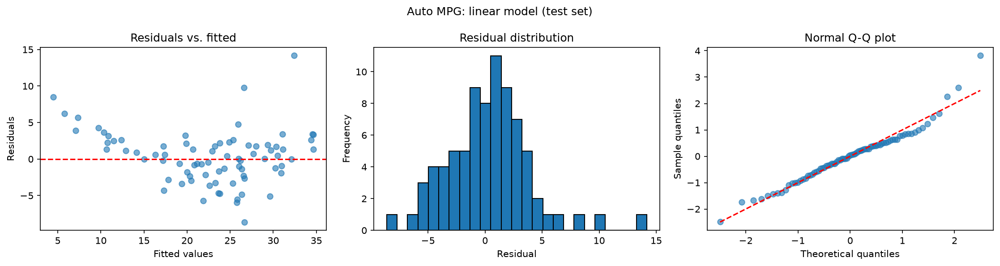
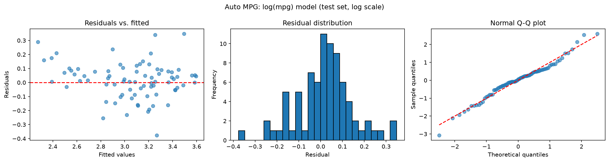

# Linear Regression From Scratch

Ordinary least squares (OLS) implemented with **NumPy only**: closed-form and gradient-descent solvers, residual diagnostics, classical and heteroskedasticity-robust standard errors, and a bootstrap cross-check. No `scikit-learn` or `statsmodels` is used to fit or validate the model.

The model is first validated on synthetic data with known coefficients, then applied to the real-world [Auto MPG](https://archive.ics.uci.edu/ml/datasets/auto+mpg) dataset, where the diagnostics expose a misspecification that is then diagnosed, corrected, and re-checked.

## Overview

| Area | What was implemented |
|---|---|
| Estimation | Closed-form OLS (`np.linalg.solve` on the normal equations) and batch gradient descent |
| Metrics | R², RMSE, MAE |
| Diagnostics | Residuals vs. fitted, residual histogram, normal Q-Q plot (quantiles computed by hand) |
| Inference | Classical standard errors, t-statistics and 95% CIs; HC3 robust standard errors |
| Validation | Comparison against `np.linalg.lstsq`; bootstrap standard errors |

## Project structure

```
regression-from-scratch/
├── regression/
│   ├── __init__.py
│   ├── model.py          # LinearRegression, standardize(), r2(), rmse(), mae()
│   ├── diagnostics.py    # residuals(), qq_points(), plot_diagnostics()
│   └── inference.py      # coef_summary(), robust_se()
├── notebooks/
│   └── analysis.ipynb    # full analysis: synthetic data -> Auto MPG
├── figures/              # plots used in this README
├── pyproject.toml
├── requirements.txt
└── README.md
```

The logic lives in the `regression` package; the notebook only imports it and tells the story.

## Methods

### Estimation

With the design matrix `X` (including a column of ones for the intercept):

- **Closed form:** solve `(XᵀX) β = Xᵀy`. `np.linalg.solve` is used instead of explicitly inverting `XᵀX`, which is more numerically stable.
- **Gradient descent:** minimize the mean squared error with the update `β ← β − lr · (2/n) · Xᵀ(Xβ − y)`. Features are standardized first so a single learning rate works across variables. The cost at every iteration is stored in `cost_history`.

### Diagnostics

`plot_diagnostics()` draws three panels:

1. **Residuals vs. fitted values:** curvature indicates a missing nonlinear term; a funnel shape indicates heteroskedasticity.
2. **Residual histogram:** should look roughly bell-shaped and centered at zero.
3. **Normal Q-Q plot:** theoretical quantiles come from `statistics.NormalDist().inv_cdf`; deviations in the tails indicate heavy tails or outliers.

### Inference

- **Classical standard errors:** `Var(β̂) = σ² (XᵀX)⁻¹`, with `σ² = RSS / (n − p)`. 95% CIs use a normal approximation (`±1.96·SE`).
- **Robust standard errors (HC3):** the sandwich estimator with leverage-adjusted residuals, which does not assume constant residual variance.
- **Bootstrap:** 1,000 resamples of the training set with replacement; the standard deviation of each refitted coefficient is used as an assumption-free reference.

## Validation

### 1. Synthetic data

Data generated from known coefficients (`intercept = 2.0`, `β = [1.5, −0.7, 3.0]`, noise `σ = 0.5`, `n = 200`). The closed-form solution matches `np.linalg.lstsq` (checked with `np.testing.assert_allclose`, `rtol=1e-8`), and gradient descent converges to the same coefficients up to a small tolerance.

I also deliberately broke the model to confirm the diagnostics work: fitting a straight line to a quadratic relationship produces a clear parabola in residuals vs. fitted, and adding the `x²` term removes it.

### 2. Standard errors on real data

Analytic, HC3, and bootstrap standard errors for the final log model on Auto MPG are compared in the [Findings](#findings) section.

## Data

[Auto MPG](https://archive.ics.uci.edu/ml/machine-learning-databases/auto-mpg/auto-mpg.data) (UCI Machine Learning Repository): fuel consumption of cars from model years 1970–1982.

- **Target:** `mpg`
- **Features:** `weight`, `horsepower`, `displacement`, `acceleration`, `model_year`
- **Cleaning:** rows with missing `horsepower` (marked `?` in the source) are dropped.
- **Split:** random 80/20 train/test split (seed 42). Features are standardized using **training-set statistics only** to avoid data leakage. The test set has roughly 80 cars.

## Results

### Linear model vs. log(mpg) model (test set)

Metrics for the log model are computed after transforming predictions back to the original scale with `np.exp`, so both rows are directly comparable.

| Model | R² | RMSE (mpg) |
|---|---|---|
| Linear (`mpg`) | 0.767 | 3.617 |
| Log (`log(mpg)`) | 0.832 | 3.069 |

### Residual diagnostics: before and after

| Linear model | Log model |
|---|---|
|  |  |

- **Linear model:** residuals vs. fitted show a U-shaped curve (the model overestimates mpg at the extremes and underestimates it in the middle), and the Q-Q plot shows a heavy right tail.
- **Log model:** the U-shape is largely gone and the right tail disappears. A small amount of curvature remains for the least efficient cars, and one outlier appears in the left tail (see [Limitations](#limitations)).

### Coefficients (log model, standardized features)

Because features are standardized and the target is in logs, `coef × 100` is approximately the **percent change in mpg per one standard deviation** of the feature.

| Variable | Coef | Robust SE (HC3) | Approx. robust t |
|---|---|---|---|
| intercept | 3.1037 | 0.0069 | – |
| weight | −0.2348 | 0.0284 | −8.3 |
| horsepower | −0.0276 | 0.0253 | −1.1 |
| displacement | −0.0090 | 0.0312 | −0.3 |
| acceleration | −0.0009 | 0.0136 | −0.1 |
| model_year | 0.1086 | 0.0078 | 13.9 |

### Full vs. reduced model (test set)

| Model | R² | RMSE (mpg) |
|---|---|---|
| Full (5 variables) | 0.832 | 3.069 |
| Reduced (`weight`, `horsepower`, `model_year`) | 0.833 | 3.068 |

## Findings

**1. The log transform fixes most of the nonlinearity.** The linear model's residuals show clear curvature and a heavy right tail. Modeling `log(mpg)` removes most of both and improves test R² from 0.767 to 0.832 and RMSE from 3.62 to 3.07 mpg.

**2. Weight and model year drive the predictions.** An increase of one standard deviation in `weight` is associated with roughly 23% lower mpg, and one standard deviation of `model_year` (about 3.7 years) with roughly 11% higher mpg, holding the other variables fixed.

**3. Multicolinearity explains the non-significant predictors.** `weight`, `displacement` and `horsepower` are strongly correlated (0.86 to 0.93). Once `weight` is in the model, the other two add little information, and their standard errors are inflated. This does *not* mean engine size does not affect fuel consumption; it means it is redundant given weight. Dropping `displacement` and `acceleration` leaves test metrics unchanged (R² 0.832 → 0.833), so the simpler model is preferable.

**4. Classical standard errors were too optimistic.** The analytic standard errors were noticeably smaller than the bootstrap ones for several variables, while HC3 landed close to the bootstrap, which points to mild heteroskedasticity:

| Variable | Analytic | HC3 | Bootstrap |
|---|---|---|---|
| intercept | 0.0068 | 0.0069 | 0.0067 |
| weight | 0.0221 | 0.0284 | 0.0268 |
| horsepower | 0.0205 | 0.0253 | 0.0233 |
| displacement | 0.0224 | 0.0312 | 0.0304 |
| acceleration | 0.0110 | 0.0136 | 0.0129 |
| model_year | 0.0076 | 0.0078 | 0.0074 |

The robust errors change the *magnitude* of the evidence (for example, the t-statistic of `weight` goes from about −10.6 to −8.3) but not the conclusions: `weight` and `model_year` remain highly significant, and the other three remain indistinguishable from zero. The hand-written HC3 estimator reproduces what the bootstrap finds without any distributional assumptions.

## Limitations

- **Outliers with a mechanical explanation.** The largest residuals of the log model belong to cars whose engine type is not captured by any feature: a Mazda RX-3 (rotary engine, much worse mpg than its weight suggests), an Audi 5000s diesel (much better mpg than a gasoline car of that weight), and a Mazda GLC with 46.6 mpg, one of the highest values in the data. These are real observations, not data-entry errors, so they were kept rather than removed to improve the metrics. Adding an engine-type variable would be the natural next step.
- **Small test set.** With roughly 80 test cars, differences of a few thousandths in R² or RMSE are noise. A cross-validated comparison would give more reliable estimates.
- **Residual curvature.** A little curvature remains at the low-mpg end after the log transform. Adding a `weight²` term is an untested option.
- **Normal-approximation CIs.** Confidence intervals use `±1.96·SE` rather than a t-distribution quantile, which is acceptable for this sample size but not for very small samples.
- **Gradient descent** needs standardized features and a hand-tuned learning rate; it is included for comparison, and the closed form is used for all reported results.

## How to run

Requires Python 3.12 or 3.13. (Python 3.14 may not have prebuilt NumPy/pandas wheels yet.)

```bash
git clone <repo-url>
cd regression-from-scratch

python -m venv .venv
# Windows (PowerShell): .venv\Scripts\Activate.ps1
# Linux / macOS:        source .venv/bin/activate

python -m pip install -r requirements.txt
python -m pip install -e .
```

Open `notebooks/analysis.ipynb` in Jupyter or VS Code, select the `.venv` kernel, and use **Run All** so the cells execute top to bottom. The Auto MPG data is downloaded directly from the UCI repository; if the URL is unavailable, download the file into a `data/` folder and point `url` in the loading cell to it.

`requirements.txt`:

```
numpy
pandas
matplotlib
ipykernel
```

## Possible extensions

- Ridge regression (closed form and gradient descent) to handle the multicolinearity directly.
- K-fold cross-validation implemented from scratch.
- A `weight²` term or an engine-type feature to address the remaining residual structure.
- Unit tests with `pytest` comparing every estimator against `np.linalg.lstsq`.
